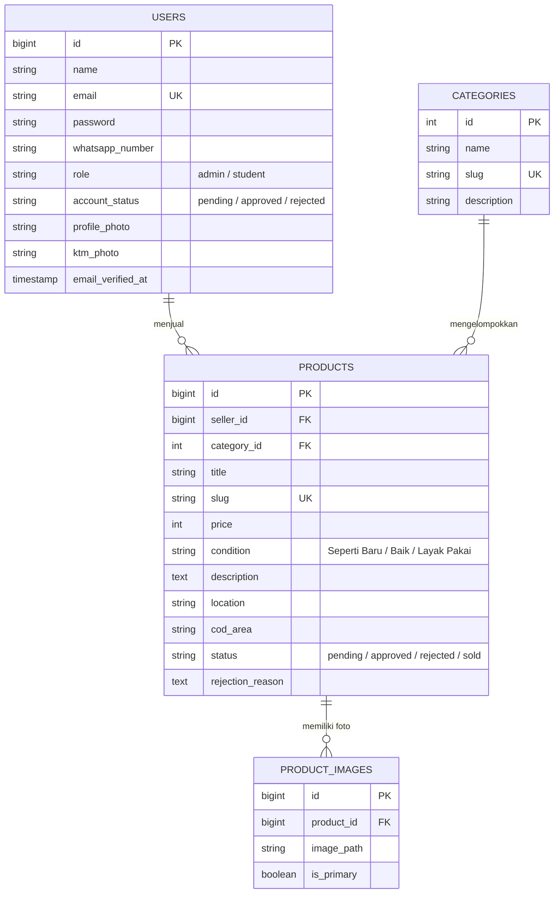

# Product Requirements Document (PRD) & Technical Guide
**Nama Proyek:** FIKOM Preloved  
**Status Proyek:** Production (Live Deployment)  
**Tujuan Dokumen:** Panduan arsitektur, spesifikasi teknis, alur fungsional, dan pedoman pemeliharaan (*Single Source of Truth*) untuk platform marketplace C2C mahasiswa FIKOM.

---

## 1. Ringkasan Eksekutif & Latar Belakang
**FIKOM Preloved** adalah platform marketplace lokal berbasis *Customer-to-Customer* (C2C) yang dikembangkan khusus untuk civitas akademika Fakultas Ilmu Komputer. Platform ini mengatasi problem sirkulasi barang bekas mahasiswa (alat praktikum, perabot kos, laptop, buku modul kuliah) dengan memfasilitasi transaksi 100% *Cash on Delivery* (COD) di titik kumpul sekitar kampus.

### Nilai Utama Platform:
* **Bebas Ongkir & Risiko Penipuan:** Transaksi tatap muka langsung di area kampus.
* **Eksklusif Mahasiswa Kampus:** Registrasi dan login dilindungi domain email resmi institusi.
* **Moderasi Terpusat:** Setiap akun penjual dan iklan barang diverifikasi oleh tim admin sebelum tayang ke publik.

---

## 2. Arsitektur Sistem & Spesifikasi Teknologi (Tech Stack)

### 2.1. Backend & Serverless Hosting
* **Framework:** Laravel 12 (PHP 8.2+)
* **Hosting Platform:** **Vercel Serverless Functions** (Runtime `vercel-php@0.7.3`)
* **Reverse Proxy & SSL:** Vercel Edge Network dengan konfigurasi `trustProxies(at: '*')`
* **Storage & Static Routing:** `vercel.json` dengan mapped static build `public/build`

### 2.2. Database & Penyimpanan Berkas Cloud
* **Database Engine:** **MySQL 8.x Cloud** hosted di **Aiven Cloud** (SSL Encrypted connection)
* **Media Storage (Gambar Produk & Foto Profil):** **Cloudinary Media CDN**
  * Unggahan gambar langsung diintegrasikan dengan Cloudinary API melalui command sinkronisasi dan model accessor sehingga sistem tidak bergantung pada storage disk server lokal (sesuai standar *stateless serverless*).

### 2.3. Frontend & Desain UI/UX
* **View Engine:** Laravel Blade Templates
* **Styling & CSS:** Tailwind CSS v3 / v4 (Kompilasi Vite produksi)
* **Interaktivitas:** Alpine.js (State modal, dual-slider harga, dropdown navbar)
* **Ikonografi:** Blade Heroicons (SVG native) & Google Fonts (Inter, Poppins, Figtree)

### 2.4. Panel Administrasi
* **Engine:** **Custom Blade & Controller Panel** (Menggantikan Filament Admin untuk memangkas konsumsi RAM dari 100MB+ menjadi <30MB per request, optimal untuk hosting serverless/shared).
* **Autentikasi Multi-Guard:** Guard khusus `'admin'` dengan session dan middleware `EnsureUserIsAdmin`.

---

## 3. Fitur Utama & Alur Pengguna

### 3.1. Autentikasi Khusus Kampus (SSO Guard)
* Validasi ketat format email pendaftaran: `@mhs.udb.ac.id`.
* Proteksi akun berjenjang (`pending`, `approved`, `suspended`). Mahasiswa yang baru mendaftar tidak dapat langsung mengunggah iklan sebelum statusnya disetujui admin.

### 3.2. Katalog & Filter Presisi
* **Dual-Knob Slider Harga:** Rentang harga dinamis Rp 0 hingga Rp 1.000.000 dengan step kelipatan Rp 25.000 dan input format Rupiah dua arah.
* **Standardisasi 3 Kondisi Produk:** `Seperti Baru`, `Baik`, dan `Layak Pakai`.
* **Kategori Cepat:** 7 Kategori unggulan dengan metadata ikon SVG dan rute pencarian instan.
* **Format Waktu Relatif Bahasa Indonesia:** Menggunakan `diffForHumans()` terjemahan bahasa Indonesia (misal: *"1 hari yang lalu"*, *"6 hari yang lalu"*).

### 3.3. Transaksi & Kontak Terintegrasi WhatsApp
* Tanpa sistem pembayaran/keranjang pihak ketiga yang rumit.
* Tombol CTA *"Chat Penjual via WhatsApp"* secara otomatis memformat nomor telepon internasional (`62xxx`) beserta draf pesan terstruktur berisi nama barang, harga, dan permintaan lokasi COD.

### 3.4. Dashboard Admin Kustom
* **Ikhtisar Statistik:** Metrik barang aktif, butuh verifikasi, barang terjual, perputaran omset, dan total mahasiswa.
* **Moderasi Barang:** Pencarian, filter status (`pending`, `approved`, `rejected`), persetujuan instan, dan penolakan dengan alasan (`rejection_reason`).
* **Moderasi Pengguna:** Verifikasi identitas/KTM mahasiswa, persetujuan akun, penangguhan (*suspend*), dan penghapusan akun bermasalah.
* **Manajemen Barang Terjual:** Riwayat sirkulasi barang yang telah laku dengan opsi reaktivasi.

---

## 4. Struktur Database (Schema)



---

## 5. Konfigurasi Deployment Vercel

```json
{
  "version": 2,
  "framework": null,
  "outputDirectory": "public",
  "functions": {
    "api/index.php": {
      "runtime": "vercel-php@0.7.3"
    }
  },
  "routes": [
    { "src": "/build/(.*)", "dest": "/public/build/$1" },
    { "src": "/images/(.*)", "dest": "/public/images/$1" },
    { "src": "/admin-assets/(.*)", "dest": "/public/admin-assets/$1" },
    { "src": "/favicon.ico", "dest": "/public/favicon.ico" },
    { "src": "/favicon.png", "dest": "/public/favicon.png" },
    { "src": "/robots.txt", "dest": "/public/robots.txt" },
    { "src": "/(.*)", "dest": "/api/index.php" }
  ]
}
```

---

## 6. Pengujian & Kualitas Perangkat Lunak (QA)
* **Automated Feature Tests:** 27 pengujian PHPUnit meliputi autentikasi, registrasi email kampus, rute publik, middleware, dan katalog.
* **Hasil Pengujian:** **100% Passed (65 assertions)**.
* **Aksesibilitas & Responsivitas:** Diuji pada tampilan desktop, tablet, dan smartphone (resolusi 360px–420px) dengan navbar navigasi adaptif (*Masuk*, *Daftar*, *Mulai Jual*).